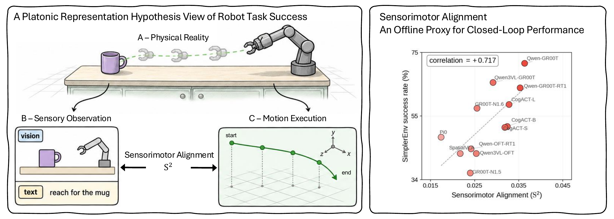
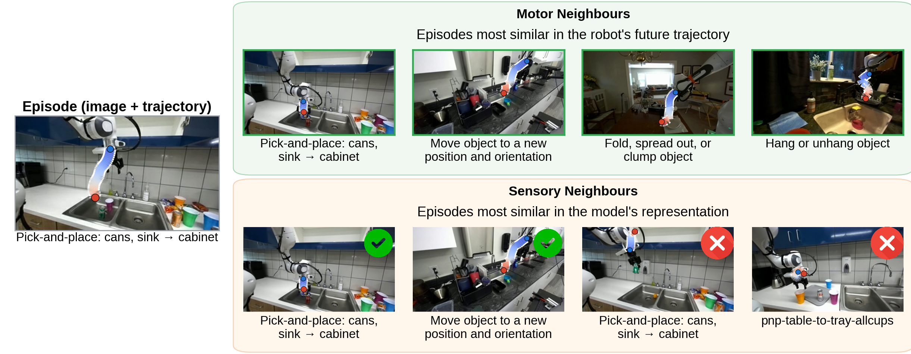

<h1 align="center">Sensorimotor Alignment:<br>A Platonic Proxy for Embodied Policy Success</h1>

<p align="center">
  <a href="https://yunfeixie233.github.io/">Yunfei Xie</a><sup>1</sup>,
  <a href="https://howardqian201.github.io/">Howard H. Qian</a><sup>1</sup>,
  <a href="https://voidrank.github.io/">Shiyi Lan</a><sup>2</sup>,
  <a href="https://hangkaiyu.github.io/">Kaiyu Hang</a><sup>1</sup>,
  <a href="https://weichen582.github.io/">Chen Wei</a><sup>1</sup>
  <br>
  <sup>1</sup>Rice University, <sup>2</sup>NVIDIA
</p>

<p align="center">
  <a href="https://yunfeixie233.github.io/s2/">Project website</a> ·
  <a href="#getting-started">Getting started</a> ·
  <a href="#reproduction-guides">Reproduction guides</a> ·
  <a href="#citation">Citation</a>
</p>



## Abstract

Robotic foundation models are typically evaluated through costly closed-loop rollouts, which motivates cheap offline proxies for model capability. The Platonic Representation Hypothesis (PRH) suggests that as representations improve, different modalities such as vision and language converge toward a shared statistical model of reality. We ask whether motion trajectories form another such modality: as robot models become more capable, should their sensory representations converge toward the structure of physical motion? To examine this, we propose **Sensorimotor Alignment** (S²), a training-free offline metric that measures how well a model's sensory representation aligns with the geometry of physical motion. We find that S² correlates positively with downstream robot task success across embodied model families, making it a low-cost offline proxy for prioritizing models before closed-loop evaluation. S² can also identify promising vision-language model (VLM) backbones even *before* costly fine-tuning into vision-language-action models (VLAs). Beyond this correlation, S² offers representation-level explanations for phenomena observed in VLAs and world action models (WAMs). With S², we extend PRH to embodied models and make sensorimotor alignment empirically measurable, offering insight into why an embodied model succeeds beyond its closed-loop success rate.

## Getting started

You can inspect the [released result tables](record/README.md) directly, or regenerate a figure on CPU without downloading models or robot datasets:

```bash
git clone https://github.com/yunfeixie233/sensorimotor-alignment.git
cd sensorimotor-alignment
python3 -m venv envs/figures
source envs/figures/bin/activate
python -m pip install numpy scipy matplotlib adjustText
python record/fig_3.1_cross_embodiment/code/regen_cross_embodiment_vla.py
```

The script writes `record/fig_3.1_cross_embodiment/cross_embodiment_vla.pdf` and `.png`. For model extraction and S² computation, follow [Setup](docs/setup.md), then choose an experiment below.

## Reproduction guides

Run guide commands from the repository root in Bash. Each experiment guide includes its dataset commands; **skip downloads and preparation when the same dataset and settings are already available**.

| Task | Guide |
|---|---|
| Inspect scores or regenerate released figures | [Result tables and figure commands](record/README.md) |
| Set up model environments or diagnose installation problems | [Setup and troubleshooting](docs/setup.md) |
| Compute S² for the 12 fine-tuned VLAs | [VLA reproduction](docs/reproduce-vla.md) |
| Compute S² for the 8 raw VLM backbones | [VLM reproduction](docs/reproduce-vlm.md) |
| Inspect the WAM results and available extraction code | [WAM reproduction and release coverage](docs/reproduce-wam.md) |
| Reproduce modality, frozen-encoder, denoising, and layer analyses | [Representation-level explanations](docs/diagnostics.md) |
| Find model families and checkpoint sources | [Model catalog](docs/models.md) |
| Understand feature files, cache layout, or score another model | [Pipeline reference](docs/reference.md) |

## Paper results and release coverage

The current paper's §3.1 compares S² with task success across the following cohorts. The code release contains an earlier subset of the experiments; the guides distinguish released results from work still needed for full reproduction.

| Cohort | Reference / evaluation | Pearson r in the paper | Released coverage |
|---|---|---|---|
| 12 VLAs | DROID / SimplerEnv | +0.717 | Scores, extraction scripts, and plots |
| 8 raw VLMs | DROID / SimplerEnv success of the resulting VLAs | +0.681 | Scores, extraction scripts, and plots |
| 6 WAMs | ALOHA / RoboTwin 2.0 | +0.718 | Scores and plots for Motus, LingBot-VA, and Vidar; full six-model reproduction is incomplete |
| 5 real-robot policies | DROID / MolmoB0T's physical-robot evaluation | +0.831 | Reproduction recipe and result bundle are not included |

The real-robot result uses the exploratory horizon `h=110`; the prespecified `h=7` gives `r=+0.429`, as stated in the paper. The three-WAM video-quality comparison belongs to §3.2 and is distinct from the six-WAM result above. See the [result index](record/README.md) for differences between the released plots and the current manuscript.

## How S² is computed

1. Prepare a fixed set of episodes with observations, instructions, and recorded trajectories.
2. Extract sensory features from a model without updating its weights.
3. Compute motor neighbors using Dynamic Time Warping (DTW) on trajectories.
4. Compare sensory and motor neighborhoods with Centered Kernel Nearest-Neighbor Alignment (CKNNA).
5. Compare the resulting S² scores with downstream task success.

The [pipeline reference](docs/reference.md) describes feature positions, trajectory representations, and cache reuse. For a small metric example, see [the CUDA demo](docs/setup.md#small-metric-demo).



For one DROID observation, the example compares four motor-neighbor episodes with neighbors in sensory-feature space. A model with higher S² recovers more of the trajectory-similar neighbors.

See [resource estimates and cache reuse](docs/reference.md#resource-estimates-from-the-original-release) before a full run.

## Repository layout

```text
README.md        Project overview and guide navigation
paths.env.example Machine-local path template
config.py        Path-configuration loader
docs/            Setup, experiment guides, model catalog, and pipeline reference
data/            Dataset preparation
extractors/      Model feature extraction
compute/         DTW and CKNNA computation; small example
record/          Released result tables and figure scripts
analysis/        Supporting analyses
vision_encoder/  Additional vision-encoder experiments
repro_envs/      Environment snapshots
repos/           Bundled upstream model code
tests/           Path, import, and extraction checks
```

## Citation

```bibtex
@misc{xie2026sensorimotoralignment,
  title = {Sensorimotor Alignment: A Platonic Proxy for Embodied Policy Success},
  author = {Xie, Yunfei and Qian, Howard H. and Lan, Shiyi and Hang, Kaiyu and Wei, Chen},
  year = {2026},
  url = {https://yunfeixie233.github.io/s2/}
}
```

## Acknowledgements and license

Our metric builds on CKNNA from [The Platonic Representation Hypothesis](https://github.com/minyoungg/platonic-rep). We thank the authors of the model, dataset, and evaluation releases used in this project; see [upstream acknowledgements](docs/acknowledgements.md). See [LICENSE](LICENSE) and the licenses accompanying the code under `repos/`.

The [original README](docs/archive/README.md) is preserved with the documentation for comparison.
