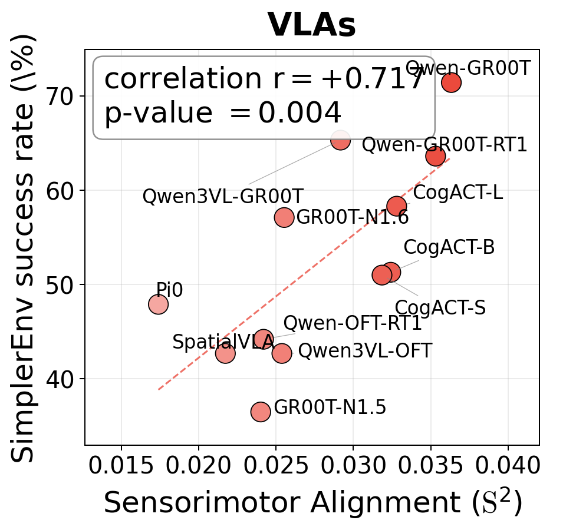

# Reproducing VLA results

[README](../README.md) · [Setup](setup.md) · [Figure commands](../record/README.md)

The paper's §3.1 evaluates 12 fine-tuned VLAs on SimplerEnv; §3.3 checks reference-dataset and horizon robustness. Complete [Setup](setup.md), load `paths.env`, and run the following from the repository root in Bash.

Skip a download when its raw data are already present. Skip preparation only when the existing subset uses the same sampling settings and episode order.

The canonical cohort, with HuggingFace checkpoint IDs and per-model SR values, is committed at `record/fig_3.1_pa_predicts_sr_1x3/data/widowx_sr.csv`.

## Environments

```bash
for env in cogact groot_libero pi0fast_env spatialvla_env; do
    conda env create -f repro_envs/yaml/$env.yaml
done
```

The `cogact` env loads the gated `meta-llama/Llama-2-7b-hf` checkpoint at runtime, so set `HF_TOKEN` in `paths.env` before the first extraction. After creating `groot_libero`, run `conda run -n groot_libero python -m pip install -e repos/Isaac-GR00T-N15` to pick up the extra deps in the GR00T-N1.5 `pyproject.toml`.

## 1. Dataset preparation

> Skip a dataset's download if its raw files are present. Skip its preparation if the complete cache (images, metadata, and trajectories) already uses the settings below. BridgeDataV2 is optional for the DROID result.

DROID v1.0.1 (primary):

```bash
conda run -n starVLA python -m pip install gsutil
mkdir -p "$DROID_RLDS_DIR" && cd "$DROID_RLDS_DIR"
conda run -n starVLA gsutil -m cp -r 'gs://gresearch/robotics/droid/1.0.1/*' .          # ≈ 1.7 TB raw
cd -
conda run -n starVLA python data/load_droid_rlds.py \
    --output_dir "$DATA_STORE/cknna_data_droid" \
    --max_horizon 220 --min_length 441 --max_samples 6000 --seed 42
```

BridgeDataV2 (in-embodiment reference for the cross-embodiment robustness check, ~124 GB):

```bash
mkdir -p "$BRIDGE_RLDS_DIR" && cd "$BRIDGE_RLDS_DIR"
wget --recursive --no-parent --no-host-directories --cut-dirs=4 \
    --reject "index.html*,*\?C=*" \
    https://rail.eecs.berkeley.edu/datasets/bridge_release/data/tfds/bridge_dataset/1.0.0/
cd -
CUDA_VISIBLE_DEVICES="" conda run -n starVLA python data/load_bridge_rlds.py \
    --output_dir "$DATA_STORE/cknna_data_bridge_raw" --max_horizon 40 --seed 42
conda run -n starVLA python data/build_bridge_filtered.py \
    --src_dir "$DATA_STORE/cknna_data_bridge_raw" \
    --dst_dir "$DATA_STORE/cknna_data_bridge" \
    --min_horizon 40 --task_cap 3
```

`CUDA_VISIBLE_DEVICES=""` keeps TensorFlow off the GPU during RLDS reading.

**BridgeDataV2 extraction needs an additional preparation step.** `build_bridge_filtered.py` filters metadata and trajectories but symlinks the original image directory. The listed extractors read sequential image filenames and do not apply `metadata.json`'s `index_map`. Remap the images to the filtered episode order before extracting on BridgeDataV2; the release does not yet supply that adapter. The extraction loop below therefore runs DROID only. The committed BridgeDataV2 scores remain available for figure regeneration.

## 2. Feature extraction (7 features per VLA)

The seven feature positions use the filenames below. The scorer reads `feats_A.pt` for the joint LLM output, including for VLAs:

| File                       | Position    | What it captures                                                |
|----------------------------|-------------|-----------------------------------------------------------------|
| `feats_A_vit.pt`           | ViT-out     | Vision encoder output (the image tokens before the LLM)         |
| `feats_A_pre_llm.pt`       | LLM-in V    | Vision tokens entering the LLM                                  |
| `feats_A_pre_llm_txt.pt`   | LLM-in T    | Text tokens entering the LLM                                    |
| `feats_A_pre_llm_vt.pt`    | LLM-in V+T  | Joint vision-text input to the LLM                              |
| `feats_A_img.pt`           | LLM-out V   | Vision-token activations leaving the LLM                        |
| `feats_A_txt.pt`           | LLM-out T   | Text-token activations leaving the LLM                          |
| `feats_A.pt`              | LLM-out V+T | Joint activations leaving the LLM (the action head's input)     |

**The §3.1 headline figure uses `feats_A.pt` (LLM-out V+T) at trajectory horizon `h=7`.** The other six positions are not on the headline scatter; they drive the §4.1 modality-decomposition diagnostic.

Each model family uses its own conda env. The block below extracts all 12 VLAs on DROID. BridgeDataV2 needs the image-index correction described above before extraction. Checkpoint IDs and output-directory names follow [`widowx_sr.csv`](../record/fig_3.1_pa_predicts_sr_1x3/data/widowx_sr.csv).

```bash
for refdataset in droid; do
    DATA_DIR="$DATA_STORE/cknna_data_$refdataset"
    OUT_BASE="$DATA_STORE/cknna_data_${refdataset}_7feat"

    # ── CogACT (3 models: Small / Base / Large). The DiT action-head variant
    #    must match the checkpoint: DiT-S for Small, DiT-B for Base, DiT-L for Large. ──
    while IFS=, read -r hf_id dit name; do
        conda run -n cogact python extractors/extract_7feat_cogact.py \
            --ckpt              "$hf_id" \
            --action_model_type "$dit" \
            --data_dir          "$DATA_DIR" \
            --output_dir        "$OUT_BASE/$name"
    done <<'EOF'
CogACT/CogACT-Small,DiT-S,cogact-small-bridge
CogACT/CogACT-Base,DiT-B,cogact-base-bridge
CogACT/CogACT-Large,DiT-L,cogact-large-bridge
EOF

    # ── GR00T (2 models: N1.5 / N1.6) ─────────────────────────────────────────
    while IFS=, read -r version hf_id name; do
        conda run -n groot_libero python extractors/extract_7feat_groot.py \
            --version    "$version" \
            --ckpt       "$hf_id" \
            --data_dir   "$DATA_DIR" \
            --output_dir "$OUT_BASE/$name"
    done <<'EOF'
n15,ShuaiYang03/GR00T-N1.5-Lerobot-SimplerEnv-BridgeV2,groot-n15-bridge
n16,nvidia/GR00T-N1.6-bridge,groot-n16-bridge
EOF

    # ── Pi0 (1 model) ─────────────────────────────────────────────────────────
    conda run -n pi0fast_env python extractors/extract_7feat_pi0.py \
        --ckpt_path  HaomingSong/lerobot-pi0-bridge \
        --data_dir   "$DATA_DIR" \
        --output_dir "$OUT_BASE/pi0-lerobot-bridge"

    # ── SpatialVLA (1 model) ──────────────────────────────────────────────────
    conda run -n spatialvla_env python extractors/extract_7feat_spatialvla.py \
        --ckpt       IPEC-COMMUNITY/spatialvla-4b-224-sft-bridge \
        --data_dir   "$DATA_DIR" \
        --output_dir "$OUT_BASE/spatialvla-sft-bridge"

    # ── StarVLA (5 models). The extractor reads a local .pt path, so we
    #    download each HuggingFace bundle and auto-pick the latest
    #    steps_*_pytorch_model.pt that ships in checkpoints/ ──────────────────
    while IFS=, read -r hf_id name; do
        local_dir="checkpoints/$hf_id"
        conda run -n starVLA hf download "$hf_id" --local-dir "$local_dir"
        ckpt_pt=$(ls "$local_dir"/checkpoints/steps_*_pytorch_model.pt 2>/dev/null | sort -V | tail -1)
        conda run -n starVLA python extractors/extract_7feat_starvla.py \
            --ckpt_path  "$ckpt_pt" \
            --data_dir   "$DATA_DIR" \
            --output_dir "$OUT_BASE/$name"
    done <<'EOF'
StarVLA/Qwen-GR00T-Bridge,Qwen-GR00T-Bridge
StarVLA/Qwen-PI-Bridge-RT-1,Qwen-GR00T-Bridge-RT-1
StarVLA/Qwen-OFT-Bridge-RT-1,Qwen-OFT-Bridge-RT-1
StarVLA/Qwen3VL-GR00T-Bridge-RT-1,Qwen3VL-GR00T-Bridge-RT-1
StarVLA/Qwen3VL-OFT-Bridge-RT-1,Qwen3VL-OFT-Bridge-RT-1
EOF
done
```

## 3. Motor kernel via SO(3)-geodesic DTW

```bash
# DROID
conda run -n starVLA python compute/compute_dtw.py \
    --data_dir   "$DATA_STORE/cknna_data_droid" \
    --output_dir "$DATA_STORE/record/dtw_cache/droid" \
    --horizons 1 3 7 15 25 40 75 110 150 220 --topk 10

# Bridge (after preparing aligned data; smaller horizon set, since Bridge episode lengths cap at 41)
conda run -n starVLA python compute/compute_dtw.py \
    --data_dir   "$DATA_STORE/cknna_data_bridge" \
    --output_dir "$DATA_STORE/record/dtw_cache/bridge" \
    --horizons 1 3 7 15 25 40 --topk 10
```

The DTW local cost is `position L2 + quaternion geodesic + gripper L1`, symmetric2 step, no Sakoe-Chiba window (`sym2_cuda_nowin`).

## 4. Sensorimotor alignment (S²)

```bash
# DROID
conda run -n starVLA python compute/compute_cknna.py \
    --data_dir      "$DATA_STORE/cknna_data_droid" \
    --feat_dir      "$DATA_STORE/cknna_data_droid_7feat" \
    --dtw_cache_dir "$DATA_STORE/record/dtw_cache/droid" \
    --output_csv    "$DATA_STORE/results/cknna_vla_droid_complete.csv" \
    --horizons 1 3 7 15 25 40 75 110 150 220

# Bridge: requires aligned Bridge features from the preparation note above
conda run -n starVLA python compute/compute_cknna.py \
    --data_dir      "$DATA_STORE/cknna_data_bridge" \
    --feat_dir      "$DATA_STORE/cknna_data_bridge_7feat" \
    --dtw_cache_dir "$DATA_STORE/record/dtw_cache/bridge" \
    --output_csv    "$DATA_STORE/results/cknna_vla_bridgev2_complete.csv" \
    --horizons 1 3 7 15 25 40
```


## 5. Check scores and render figures

For the 12-model DROID cohort, compare the `imgtext`, `horizon=7` rows with the [released scores](../record/fig_3.1_pa_predicts_sr_1x3/data/cknna_vla_droid_complete.csv). The paper reports `r=+0.717`. The BridgeDataV2 reference result uses `h=15` and reports `r=+0.699`.

New scores above go to `$DATA_STORE/results/`. Figure scripts read their own committed `record/fig_*/data/` copies; they do not automatically read the new CSV. After checking the new run, use a separate checkout or figure folder to substitute the corresponding input tables. Keep the original tables for comparison.

The [figure guide](../record/README.md) lists the plot commands. The released combined scatter has three panels and a three-WAM cohort; it does not reproduce the current paper's four-panel result.

## Released result preview


