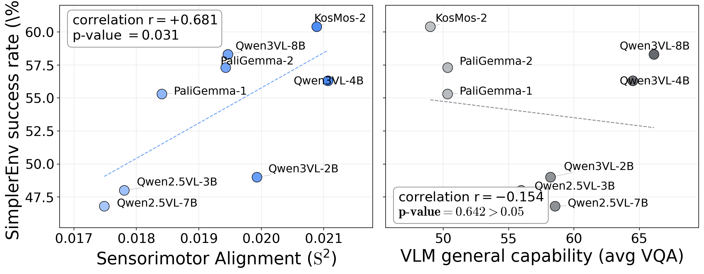

# Reproducing raw-VLM results

[README](../README.md) · [Setup](setup.md) · [Figure commands](../record/README.md)

The paper's §3.1 scores 8 raw VLMs before robot fine-tuning and compares S² with the task success of the resulting VLAs. §3.2 compares this correlation with aggregate VQA scores. Complete [Setup](setup.md), load `paths.env`, and run the following from the repository root in Bash.

Skip the DROID download if its raw files are already present. Skip preparation and reuse the motor cache when they use the same 6,000-episode subset and sampling settings as the VLA guide.

Per-model VLA success rates and VQA scores are in `record/fig_3.1_pa_predicts_sr_1x3/data/benchmark_sr.csv`.

## Environment

Use the `starVLA` environment from [Setup](setup.md) for the 8 raw VLMs.

## 1. Dataset preparation

> Skip the download if the raw DROID files are present. Skip preparation if the complete cache (images, metadata, and trajectories) already uses the settings below, for example from the [VLA guide](reproduce-vla.md).

DROID v1.0.1 (only):

```bash
conda run -n starVLA python -m pip install gsutil
mkdir -p "$DROID_RLDS_DIR" && cd "$DROID_RLDS_DIR"
conda run -n starVLA gsutil -m cp -r 'gs://gresearch/robotics/droid/1.0.1/*' .          # ≈ 1.7 TB raw
cd -
conda run -n starVLA python data/load_droid_rlds.py \
    --output_dir "$DATA_STORE/cknna_data_droid" \
    --max_horizon 220 --min_length 441 --max_samples 6000 --seed 42
```

## 2. Feature extraction (7 features per raw VLM)

`extract_all_features.py` produces 7 feature views per raw VLM in a single forward pass, identical positions to the VLA-SR extractor: ViT-out, V / T / V+T at the LLM input, and V / T / V+T at the LLM output. The text-bearing positions mean-pool only the task-instruction tokens.

| File                       | Position    |
|----------------------------|-------------|
| `feats_A_vit.pt`           | ViT-out     |
| `feats_A_pre_llm.pt`       | LLM-in V    |
| `feats_A_pre_llm_txt.pt`   | LLM-in T    |
| `feats_A_pre_llm_vt.pt`    | LLM-in V+T  |
| `feats_A_img.pt`           | LLM-out V   |
| `feats_A_txt.pt`           | LLM-out T   |
| `feats_A.pt`               | LLM-out V+T |

**The §3.1 raw-VLM result uses `feats_A.pt` (LLM-out V+T) at trajectory horizon `h=3`.** The §4.1 modality-decomposition diagnostic uses the three LLM-out variants `feats_A_img.pt`, `feats_A_txt.pt`, and `feats_A.pt`.

> The two PaliGemma models below are gated on HuggingFace. Accept the license on https://huggingface.co/google/paligemma-3b-mix-224 and https://huggingface.co/google/paligemma2-3b-mix-224, then export `HF_TOKEN=hf_…` (or set it in `paths.env`) before running the loop.

```bash
# (HuggingFace model id, model_family flag, output directory name)
declare -A VLMS=(
    [microsoft/kosmos-2-patch14-224]="kosmos2  kosmos2-raw"
    [google/paligemma-3b-mix-224]="paligemma  paligemma1-raw"
    [google/paligemma2-3b-mix-224]="paligemma  paligemma2-raw"
    [Qwen/Qwen2.5-VL-3B-Instruct]="qwen2.5  qwen25vl-3b-raw"
    [Qwen/Qwen2.5-VL-7B-Instruct]="qwen2.5  qwen25vl-7b-raw"
    [Qwen/Qwen3-VL-2B-Instruct]="qwen3  qwen3vl-2b-raw"
    [Qwen/Qwen3-VL-4B-Instruct]="qwen3  qwen3vl-4b-raw"
    [Qwen/Qwen3-VL-8B-Instruct]="qwen3  qwen3vl-8b-raw"
)
for model_path in "${!VLMS[@]}"; do
    read family name <<< "${VLMS[$model_path]}"
    conda run -n starVLA python extractors/extract_all_features.py \
        --model_path   "$model_path" \
        --model_family "$family" \
        --data_dir     "$DATA_STORE/cknna_data_droid" \
        --output_dir   "$DATA_STORE/cknna_data_droid_11feat/$name"
done
```

The 8 raw VLMs total ≈ 8 GB on disk after extraction.

## 3. Motor kernel (DTW)

The DROID motor kernel is identical to the [VLA-SR](reproduce-vla.md) motor-kernel call. The script skips each requested horizon whose cache already exists:

```bash
conda run -n starVLA python compute/compute_dtw.py \
        --data_dir   "$DATA_STORE/cknna_data_droid" \
        --output_dir "$DATA_STORE/record/dtw_cache/droid" \
        --horizons 1 3 7 15 25 40 75 110 150 220 --topk 10
```

## 4. Sensorimotor alignment (S²)

```bash
conda run -n starVLA python compute/compute_cknna.py \
    --data_dir      "$DATA_STORE/cknna_data_droid" \
    --feat_dir      "$DATA_STORE/cknna_data_droid_11feat" \
    --dtw_cache_dir "$DATA_STORE/record/dtw_cache/droid" \
    --output_csv    "$DATA_STORE/results/cknna_vlm_droid_complete.csv" \
    --horizons 1 3 7 15 25 40 75 110 150 220 \
    --model_filter '.*-raw$'
```


## 5. Check scores and render figures

Compare `imgtext`, `horizon=3` rows with the [released raw-VLM table](../record/fig_3.2_pa_vs_vqa_simpler/data/cknna_vlm_droid_complete.csv). The paper reports `r=+0.681` for S² and `r=−0.154` for aggregate VQA scores on these 8 backbones.

The figure scripts read the committed tables, not the new CSV under `$DATA_STORE/results/`. Keep both copies until you have checked the output; see [figure inputs and commands](../record/README.md).

```bash
conda run -n starVLA python record/fig_3.2_pa_vs_vqa_simpler/code/regen_pa_vs_vqa_simpler.py
conda run -n starVLA python record/fig_4.1_vt_what_carries_2x3/code/regen_what_carries_2x3.py
```

## Released result preview


