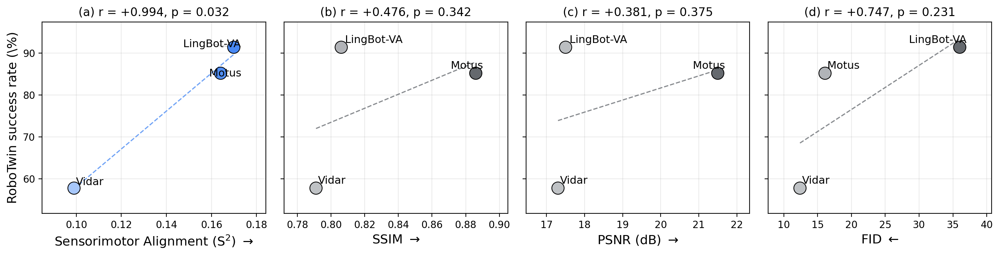

# WAM results and reproduction coverage

[README](../README.md) · [Setup](setup.md) · [Figure commands](../record/README.md)

The current paper's §3.1 evaluates **6 WAMs** on ALOHA against RoboTwin 2.0 success: Vidar, LingBot-VA, Motus, Fast-WAM, FlowWAM, and Kairos. It reports `r=+0.718` using video-backbone Block 7, `h=15`, and `k=10`.

The released result bundle covers **3 WAMs**: Motus, LingBot-VA, and Vidar. These also form the paper's §3.2 video-quality comparison. Its reported S² correlation is `r=+0.999`; the released scripts use older inputs and do not exactly reproduce all current-paper numbers. The [result index](../record/README.md) identifies this distinction.

## Regenerate the released plots

Use the CPU figure environment from [Getting started](../README.md#getting-started), then run from the repository root:

```bash
python record/fig_3.3_pa_vs_video_quality/code/regen_pa_vs_video_quality.py
python record/fig_3.3_va_sr_aloha_vs_droid/code/regen_va_sr_aloha_vs_droid.py
```

These commands use the committed tables and require no new data, features, or simulator rollouts.

## Preparing to recompute WAM features

Full reproduction from raw data is incomplete in this release. The steps below describe available components and their prerequisites; they are not a complete six-model recipe.

After [Setup](setup.md), create only the environments you need:

```bash
for env in motus lingbot_va vidar; do
    conda env create -f "repro_envs/yaml/$env.yaml"
done
```

## ALOHA data

Skip downloads already present under `$WORK/datasets/aloha_lerobot`. Reuse a prepared cache only when it preserves the original episode order and sampling.

ALOHA bimanual (motor reference). Pulled from HuggingFace; N=839 episodes from 15 `lerobot/aloha_static_*` datasets:

```bash
ALOHA_DIR="${WORK}/datasets/aloha_lerobot" && mkdir -p "$ALOHA_DIR"
for d in coffee coffee_new towel screw_driver fork_pick_up battery \
         vinh_cup vinh_cup_left ziploc_slide candy thread_velcro \
         cups_open pingpong_test pro_pencil tape; do
    conda run -n starVLA hf download "lerobot/aloha_static_$d" \
        --repo-type dataset --local-dir "$ALOHA_DIR/aloha_static_$d"
done
```

(The `hf` CLI ships with `huggingface_hub >= 1.0`, which is already in the `starVLA` env. If you use an older env where `huggingface-cli` is the active binary, swap `hf` for `huggingface-cli` — the subcommand syntax is identical.)

The original experiment used 839 episodes after dropping one parquet/video mismatch. Downloading these files does not create the prepared `cknna_data_aloha` cache. The release does not include the subset-conversion script that fixes episode order, selects frames, and writes `metadata.json`, images, and `feats_B_seq.pt`.


## Available extraction code

| Extractor | Input and output |
|---|---|
| [`motus/extract_features.py`](../extractors/motus/extract_features.py) | Prepared images and instructions; pooled features in `feats_A.pt` |
| [`lingbot_va/extract_features.py`](../extractors/lingbot_va/extract_features.py) | Prepared images and instructions; `feats_A.pt`, plus `feats_A_layers.pt` with `--save_layers` |
| [`extract_va_features_vidar_droid.py`](../extractors/extract_va_features_vidar_droid.py) | Prepared multi-camera observations; files including `feats_A_block7.pt`, `feats_A_block14.pt`, and `feats_A_norm.pt` |

These scripts process recorded reference observations offline. They do not themselves run closed-loop RoboTwin evaluations. Their output formats differ; the old instruction that all three emit the same 15 feature files was incorrect.

Use each script's `--help` for checkpoint arguments and the upstream projects for checkpoint layouts: [Motus](https://github.com/jasper0314-huang/Motus), [LingBot-VA](https://github.com/LingBot-AI), and [Vidar](https://github.com/SgtVincent/Vidar). The release still needs a common adapter that selects the paper's Block 7 representation and preserves the ALOHA sample order across models.


## Checkpoint layout and extraction examples

The original checkpoint locations and arguments are retained below. These examples require the prepared ALOHA cache described above; the missing converter and common Block 7 adapter still prevent complete paper reproduction.

Skip downloads when matching checkpoints already exist. The sizes in these comments are historical estimates.

```bash
# Where to place the WAM checkpoints; change WAM_CKPT freely.
WAM_CKPT="${WORK}/checkpoints"
mkdir -p "$WAM_CKPT"

# (a) Shared Wan2.2-TI2V-5B video backbone (~10 GB; used by both Motus and Vidar).
#     The Motus extractor reads ${WAM_CKPT}/Wan2.2-TI2V-5B/Wan2.2_VAE.pth and
#     ${WAM_CKPT}/Wan2.2-TI2V-5B/config.json, so it must be a local directory.
# The original README used Wan-AI/Wan2.2-TI2V-5B-Diffusers here.
# Verify compatibility with the required root-level VAE and config before use.
# See the checkpoint-layout note below.

# (b) Motus_robotwin2 (DeepSpeed snapshot, ~5 GB). Download from the Motus
#     project page (https://github.com/jasper0314-huang/Motus) and extract so
#     that the directory contains mp_rank_00_model_states.pt + config.json:
#     ${WAM_CKPT}/Motus_robotwin2/mp_rank_00_model_states.pt
#     ${WAM_CKPT}/Motus_robotwin2/config.json

# (c) Vidar (~3 GB single-file overlay on top of Wan2.2-TI2V-5B). Download
#     vidar.pt from the Vidar project page (https://github.com/SgtVincent/Vidar)
#     and save as ${WAM_CKPT}/vidar/vidar.pt.

# (d) LingBot-VA (custom Wan2.2 fine-tune split into 4 sub-modules, ~12 GB).
#     Obtain from the LingBot-VA project page (https://github.com/LingBot-AI)
#     and place the sub-modules as:
#     ${WAM_CKPT}/lingbot-va/{transformer,vae,text_encoder,tokenizer}/
```

**Checkpoint-layout note:** the original Wan download named `Wan-AI/Wan2.2-TI2V-5B-Diffusers`. The Motus extractor explicitly opens `Wan2.2_VAE.pth` at the root of `--wan_path`. A Diffusers bundle must not be assumed to supply that layout. Verify or obtain the upstream layout required by the extractor before running it.

With compatible checkpoints and prepared inputs, these are the model-specific invocations from the original guide:

```bash
# Motus: --vlm_path accepts a bare HuggingFace ID, no local copy needed.
conda run -n motus python extractors/motus/extract_features.py \
    --checkpoint_path "${WAM_CKPT}/Motus_robotwin2" \
    --wan_path        "${WAM_CKPT}/Wan2.2-TI2V-5B" \
    --vlm_path        "Qwen/Qwen3-VL-2B-Instruct" \
    --data_dir        "$DATA_STORE/cknna_data_aloha" \
    --output_dir      "$DATA_STORE/cknna_data_aloha_15feat/motus"

# LingBot-VA (Wan2.2 transformer + VAE + T5 text encoder)
conda run -n lingbot_va python extractors/lingbot_va/extract_features.py \
    --transformer_path  "${WAM_CKPT}/lingbot-va/transformer" \
    --vae_path          "${WAM_CKPT}/lingbot-va/vae" \
    --text_encoder_path "${WAM_CKPT}/lingbot-va/text_encoder" \
    --tokenizer_path    "${WAM_CKPT}/lingbot-va/tokenizer" \
    --data_dir          "$DATA_STORE/cknna_data_aloha" \
    --output_dir        "$DATA_STORE/cknna_data_aloha_15feat/lingbot-va"

# Vidar: picks up the Wan2.2 base and vidar.pt via two env vars.
CKPT_WAN22_TI2V_5B="${WAM_CKPT}/Wan2.2-TI2V-5B" \
CKPT_VIDAR="${WAM_CKPT}/vidar/vidar.pt" \
conda run -n vidar python extractors/extract_va_features_vidar_droid.py \
    --data_dir   "$DATA_STORE/cknna_data_aloha" \
    --output_dir "$DATA_STORE/cknna_data_aloha_15feat/vidar" \
    --input_mode 3cam_aloha_native \
    --prompt_style vidar_aloha_prefix
```

The Vidar example includes its explicit ALOHA camera and prompt options. It expects `images/`, `images_cam2/`, and `images_cam3/`, corresponding to the high camera and left/right wrists. These commands write model-specific outputs under `$DATA_STORE/cknna_data_aloha_15feat/`. The suffix is historical and does not guarantee 15 files.

### Feature labels in the original analysis

| Channel | Original positions | Meaning |
|---|---|---|
| V | D1, B0, B7, B14, B21, B29, Norm | Video latents at projection input, sampled transformer blocks, and final normalization |
| A | D1, B0, B7, B14, B21, B29, Norm | Action-conditioned latent positions in the original analysis layout |
| T | D1 | Text-encoder conditioning |

The old guide described 7 V + 7 A + 1 T positions with filenames such as `feats_A_v_b7.pt`, `feats_A_a_d1.pt`, and `feats_A_t_d1.pt`. Those names are not a common output contract of the three listed extractors. Use the actual output table above.

The paper's WAM correlation uses V-B7 at `h=15`; the denoising analysis uses V-Norm at five native-schedule positions; the layer analysis compares D1, B0, B7, B14, B21, B29, and Norm, with the highest schedule-averaged score at B14.

## Motor neighbors

Given an already prepared ALOHA cache with `feats_B_seq.pt` and `metadata.json`, the released joint-space DTW command is:

```bash
conda run -n starVLA python compute/compute_dtw_aloha.py \
    --data_dir "$DATA_STORE/cknna_data_aloha" \
    --output_dir "$DATA_STORE/record/dtw_cache/aloha" \
    --horizons 15 --topk 10
```

For the original horizon sweep, replace `--horizons 15` with `--horizons 1 3 7 15 25 40 75 110 150 220`.

The script uses Euclidean local distance for the 14-dimensional bimanual trajectories. Check that the filtered episode count and order match the sensory features. For a known unpadded cache, `--no_padding_filter` disables the stationary-frame heuristic; only use it after checking the cache.

`compute/compute_cknna.py` recognizes the VLA/VLM filenames in the [pipeline reference](reference.md#feature-files). It does not discover WAM Block 7 files or emit the WAM `feature_source` schema. Running that generic command unchanged will not reproduce the published WAM table.

## DROID reference for the embodiment-mismatch comparison

The mismatch comparison uses the single-arm DROID reference. Its download and preparation commands are repeated here to keep this guide self-contained. Skip the download when the raw files exist, and skip preparation when the complete matching subset is already present.

```bash
conda run -n starVLA python -m pip install gsutil
mkdir -p "$DROID_RLDS_DIR" && cd "$DROID_RLDS_DIR"
conda run -n starVLA gsutil -m cp -r 'gs://gresearch/robotics/droid/1.0.1/*' .
cd -
conda run -n starVLA python data/load_droid_rlds.py \
    --output_dir "$DATA_STORE/cknna_data_droid" \
    --max_horizon 220 --min_length 441 --max_samples 6000 --seed 42
```

WAM extraction and feature selection still need to match the original DROID protocol. The released mismatch plot can be regenerated from its existing inputs without these steps.

## Remaining release work

- Supply the ALOHA preparation script and exact subset manifest.
- Connect the model-specific outputs to a common Block 7 scoring path.
- Add the six-model result bundle and the remaining model recipes.
- Supply the rollout feature/trajectory caches for the denoising and layer analyses; see [diagnostics](diagnostics.md#wam-denoising-and-layer-depth).

The real-robot result is a separate experiment. Its five-policy result bundle and reproduction recipe are also absent from this release.

## Released result preview


